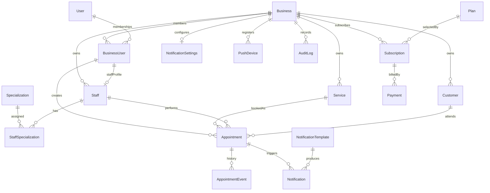

# Database

The platform uses PostgreSQL 16 through Prisma ORM. The schema is located at
`packages/database/prisma/schema.prisma`; migrations are stored under
`packages/database/prisma/migrations`.

## Entity groups

Platform identity and tenancy:

- `User`: global authenticated identity and optional platform administrator
- `Business`: tenant root
- `BusinessUser`: a user's membership and role inside one business
- `RefreshToken`: hashed, revocable authentication session and rotation chain

Business operations:

- `Staff`: employee profile, optionally linked to a `BusinessUser`
- `Specialization`: business-owned specialty catalog
- `StaffSpecialization`: normalized staff-to-specialization join
- `Customer`: business-owned customer profile (consent flags, ledger balance)
- `CustomerFile`: CRM file archive
- `Service`: business-owned and deactivatable service definition
- `Resource`: rooms / chairs for scheduling
- `Appointment`: current appointment state, service/campaign snapshots, payment plan
- `AppointmentEvent`: immutable appointment lifecycle and rescheduling history
- `Campaign` / `CampaignService`: dated discounts and optional SMS template
- `CommissionRule` / `CommissionEntry`: staff commission rules and earned rows

Pre-accounting and checkout:

- `CashAccount`, `Sale`, `SaleLine`, `Collection`, `Expense`, `CustomerLedgerEntry`
- `SalesReceipt`: internal (non-official) sales slip
- `OfficialDocument`: Uyumsoft e-Fatura / SMM linked 0..1 to a sale
- `TenantPaymentSettings`: encrypted tenant POS credentials
- `TenantUyumsoftSettings`: encrypted Uyumsoft credentials
- `CheckoutIntent`: one-time public payment-link token

Billing and communication:

- `Plan`: global subscription plan (`MONTHLY` | `SEMIANNUAL` | `YEARLY`),
  including `limits` JSON and optional `externalPricingPlanCode` for iyzico
- `Subscription`: a business's plan lifecycle, cancellation, and provider references
- `Payment`: Xenior subscription payment attempt; never contains raw card data
- `NotificationTemplate`: business-owned reusable message template
- `Notification`: scheduled or delivered message snapshot, including
  attempt count and last error
- `NotificationSettings`: per-tenant channel and reminder preferences
- `NotificationChannelConfig`: encrypted provider credentials per channel
- `PushDevice`: tenant-scoped device token for the authenticated user
- `DataRequest` / `PrivacyConsent`: KVKK export and erase requests
- `AuditLog`: append-only record of important business actions

Stock / inventory tables are intentionally absent in v1 (backlog).

## Relationship overview



`User.platformRole` separates platform authorization (`USER`, `SUPER_ADMIN`)
from tenant authorization. `BusinessUser.role` contains
`BUSINESS_OWNER`, `BUSINESS_ADMIN`, `STAFF`, and `ACCOUNTANT`.

## Tenant isolation

`Business` is the tenant. Every tenant-owned row stores a required
`businessId`. Tenant-aware unique constraints include `businessId`, allowing
different businesses to use the same service or specialization names.

Critical child relations use composite foreign keys containing both
`businessId` and the referenced identifier. This prevents a row from linking
to another tenant's customer, staff member, service, appointment,
subscription, template, or recipient even if application code makes a
mistake.

The backend must still:

1. Resolve the active `BusinessUser` from authenticated server-side context.
2. Add its `businessId` to every tenant-owned query and mutation.
3. Never accept an authoritative `businessId` from request payloads.
4. Use a separate, explicitly authorized path for `SUPER_ADMIN` operations.
5. Perform tenant scoping for reads even when querying by globally unique ID.

Composite foreign keys are defense in depth; they do not replace backend
authorization. PostgreSQL row-level security is intentionally deferred until
deployment requirements justify its operational complexity.

## Appointment history

Appointments retain their current state in `Appointment`. They are not
physically deleted. A service's name, duration, price, and currency are copied
to snapshot fields when a booking is created so later service edits cannot
rewrite history.

Every important transition appends an `AppointmentEvent`:

- `CREATED`
- `RESCHEDULED`
- `CANCELLED`
- `COMPLETED`
- `NO_SHOW`

A reschedule updates `Appointment.startAt` and `Appointment.endAt` while its
event stores the previous and new timestamps. Event and audit metadata must
remain minimal and must not contain secrets or unnecessary personal data.

Confirmed appointments for the same staff member cannot overlap. PostgreSQL
enforces this with a GiST exclusion constraint on
`tstzrange(startAt, endAt, '[)')`, so back-to-back bookings are allowed and
cancelled, completed, or no-show rows no longer occupy the calendar.

## Money

All monetary values use PostgreSQL `NUMERIC(12,2)` through Prisma `Decimal`.
JavaScript floating-point arithmetic must not be used for prices or payment
amounts. Currency values are uppercase ISO 4217 codes stored as `CHAR(3)`.

Payment rows store provider identifiers, status, amount, error information,
and non-sensitive metadata. Raw card numbers, CVV values, and reusable card
credentials must never be stored.

## Time and timezone

Business timezones use IANA identifiers such as `Europe/Istanbul`.
Appointments, periods, scheduled notifications, and audit timestamps are
stored as PostgreSQL `timestamptz` values and treated as UTC instants.

The API will convert `startAt` and `endAt` to or from the business timezone at
its boundary. A separate local date and local time are not persisted, avoiding
multiple conflicting sources of truth and daylight-saving ambiguity.

## Important constraints

- All primary IDs are UUIDs.
- User email is globally unique; the future auth layer must normalize it.
- A user can have only one membership in a business.
- A `BusinessUser` can link to at most one staff profile in that business.
- Service and specialization names are unique per business.
- A staff-specialization pair is unique.
- Appointment end time must be later than start time.
- Service durations and appointment duration snapshots must be positive.
- Prices cannot be negative; payment amounts must be positive.
- Subscription period end must be later than period start.
- A business can have only one current subscription in `TRIALING`, `ACTIVE`,
  `PAST_DUE`, or `PAUSED`.
- `Plan.limits` stores optional `maxStaff`, `maxCustomers`, and
  `advancedFeatures`. Catalog rows are seeded in migration SQL; prices are
  not application constants.
- `Subscription.cancelAtPeriodEnd` records a cancellation that still grants
  access until `currentPeriodEnd`.
- A notification must reference exactly one customer, staff, or business user.
- Provider payment and subscription identifiers are unique when present.

Checks and the partial current-subscription index that Prisma cannot express
are maintained in the initial migration SQL.

## Important indexes

The main access paths are:

- Appointments by business and start time
- Staff and customer appointment history
- Appointments by business, status, and start time
- Active staff, customers, services, and specializations per business
- Customer and staff lookup by tenant-scoped phone/name
- Business membership by user and role
- Subscription status and period end
- Payments by business, subscription, status, and creation time
- Pending notifications by business, status, and schedule
- Audit records by business/time and entity identity

Indexes are intentionally limited to expected MVP access patterns.

## Delete behavior

Historical and business-critical relations use `RESTRICT`. Appointments,
appointment events, subscriptions, payments, notifications, and audit logs
must be retained according to application and legal retention policy.

Staff, customers, services, specializations, users, and businesses use status
or `isActive` lifecycle fields instead of routine physical deletion.

`CASCADE` is used only for `StaffSpecialization`, which is a pure join record.
Audit actor deletion uses `SET NULL` so the audit entry remains available.

## Local database

Docker Compose starts PostgreSQL 16. The local connection value is stored in
ignored `.env` files:

```text
DATABASE_URL=postgresql://xenior:<local-password>@localhost:5432/xenior
```

Production credentials must be supplied by the deployment environment or a
secret manager. Never put credentials in the repository.

## Backups

PostgreSQL is the system of record. Take automated dumps (or use a managed
backup) daily, keep at least seven daily and four weekly copies, and test a
restore on staging. Redis holds queues and cache only.

Production applies committed migrations with `pnpm db:migrate:deploy`. Do not
run `prisma migrate dev` or `prisma db push` against production. Tenant
models use `businessId` composite foreign keys; do not drop those constraints
to "fix" data.

## Commands

```bash
pnpm db:format
pnpm db:validate
pnpm db:generate
pnpm db:migrate
pnpm db:migrate:status
pnpm db:migrate:deploy
```

Use `db:migrate` during local schema development. Production and CI
environments must apply committed migrations with `db:migrate:deploy`; they
must not use `prisma db push`.

No seed runs automatically. The initial migration creates structure only and
does not insert demo or production data.
